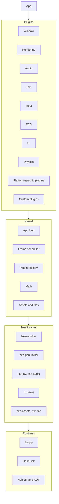

# hxnme

hxnme is an engine framework for developing games and rich interactive apps and experiences, written in Haxe. It is part
of the [hxn](https://github.com/hx-n/hxn) project. The engine consists of a
lightweight kernel and a set of plugins, each published as its own haxelib.
Apps depend on the kernel and add the plugins they need.

## Architecture

## Roadmap

1. Core: app loop, input actions, 2D renderer, assets, and `new`, `run` and
   `build` for desktop and web.
2. Physics: a GPU solve, with the CPU solve for deterministic worlds.
3. Dev loop: hot reload of code and assets, on desktop, Android and iOS.
4. Entities: ECS, scenes, prefabs, serialization and audio.
5. UI: layout, widgets, text input and accessibility.
6. 3D: frame graph, meshes, materials and post-processing.
7. Delivery: packaging, signing, and deploys to app stores and the web.

## Agent skills

Each package has an agent skill for coding agents in
[`skills/`](skills/), and the package's haxelib includes it.

## License

Apache-2.0. See [LICENSE](LICENSE).
