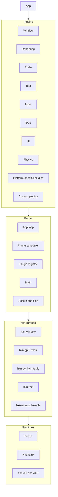

# Architecture



An hxnme app is a Haxe program with an `hxnme.toml` file that defines a set
of plugins it depends on. Each plugin is a haxelib. The `hxnme` section of
its `haxelib.json` is the plugin's manifest. It defines the plugin class, the other
plugins it depends on, the platforms it supports and the haxelibs it needs for
each target.

Plugins and the app add code to the frame in three forms:

- Systems are static functions with `@:system`. The annotation specifies the
  phase of the frame that calls the system, and the systems that run before
  or after it.
- Resources are classes that hold shared state, such as the frame time or
  the state of the keys. Each system takes the resources it uses as
  parameters: `Res<T>` to read and `ResMut<T>` to write.
- Services are interfaces that one plugin implements for the others. For
  example, the window plugin provides `Host`, which drives the frames.

The plugin below turns an angle in each frame. Its manifest in
`haxelib.json` defines the plugin class:

```json
"hxnme": {"plugin": "spin.SpinPlugin"}
```

```haxe
package spin;

import hxn.me.Res;
import hxn.me.ResMut;
import hxn.me.Time;

// @:systems lists the classes that hold the plugin's systems.
@:plugin("hxnme-spin")
@:systems(Spin)
class SpinPlugin {
	public function new() {}

	public function start():Void {}
}

// A resource. The kernel creates one instance and passes it to each system
// that takes it.
class Angle {
	public var radians = 0.0;

	public function new() {}
}

class Spin {
	@:system(Update)
	static function turn(time:Res<Time>, angle:ResMut<Angle>) {
		angle.radians += time.delta;
	}

	@:system(Update, after = turn)
	static function wrap(angle:ResMut<Angle>) {
		if (angle.radians > 2 * Math.PI)
			angle.radians -= 2 * Math.PI;
	}
}
```

The kernel's macros compose the plugins at compile time. They read
`hxnme.toml`, resolve the dependency graph of the plugins, and check each
plugin against the target platform. They sort the systems of each phase
topologically by their constraints. They then generate `Plugins`, which
starts each plugin in proper order of dependencies, and `Schedule`, which
calls each system with its resources. Missing dependencies and cycles are
compile errors.

At run time, the generated code calls plugins and systems directly, without
a registry or reflection. The `Start` phase runs once, after the plugins
start. Then each frame runs `Begin`, `Fixed` once for each fixed time step,
`Update` and `Render`.

Bulk data, such as the instances that the 2D renderer draws, is laid out as
struct-of-arrays in hxn typed buffers. The Rust libraries borrow these
buffers without a copy, and the renderer uploads them to the GPU as they are.
Per-instance work runs in shaders. For example, the 2D renderer evaluates
signed distance fields for rounded shapes, borders, shadows and clipping on
the GPU. Plugins access the platform only through the hxn libraries, so app
code is portable across runtimes.
